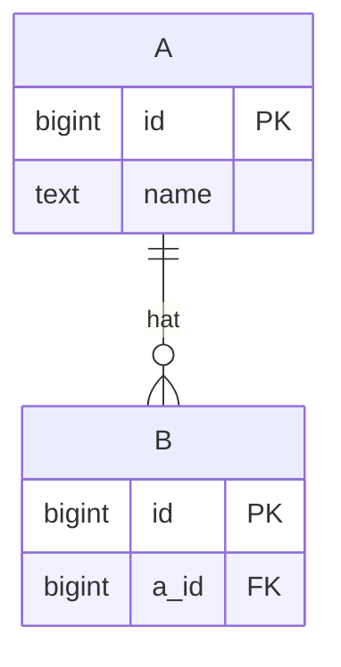
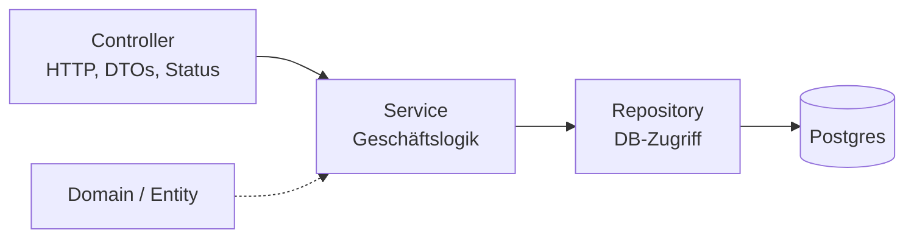
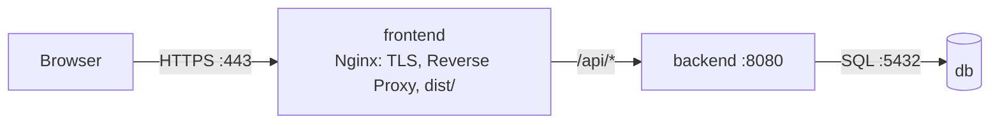
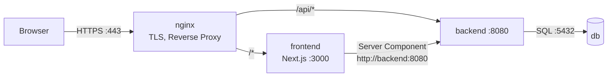

# Planungs-Template für die Aufgabe

Wird vom Skill `plan` als `.spec/planung.md` gefüllt. Annahmen sind mit **[Annahme]** markiert.

---

## Festgelegt

| Bereich | Entscheidung |
|---|---|
| Backend | Kotlin + Spring Boot (Details: Skill `backend`) |
| Datenbank | PostgreSQL (relational) |
| API-Stil | REST mit JSON |
| Sprache im Code | Englisch: Klassen, Variablen, Tabellen, Spalten, Endpunkte, JSON-Felder, Commits, PRs. Nur sichtbare Texte in der UI auf Deutsch |
| Frontend | Vite + React oder Next.js, Entscheidung in Abschnitt 5 (Details: Skill `frontend`) |
| Repo | Monorepo: `backend/`, `frontend/`, `docker-compose.yml`, `docker-compose.local.yml`, `.env.example`, `README.md` |
| Git | Ein Feature-Branch pro Schritt aus Abschnitt 7 (z.B. `feature/backend`, `feature/frontend`). Claude committet, pusht und öffnet den PR (`gh pr create`). Ich reviewe und merge |
| Container | Docker + Docker Compose |
| Server | Linux-Server, wird gestellt |
| HTTPS (falls nötig) | Let's Encrypt per certbot (`--standalone` + Hooks), Nginx terminiert TLS |
| Secrets | `.env` nie committen (lokal und auf dem Server je eine), im Repo nur `.env.example` |
| Code auf den Server | privates GitHub-Repo, auf dem Server per Deploy Key (read-only) geklont |

---

## 1. Scope: User Stories

| # | Als ... möchte ich ... | Must / Nice |
|---|---|---|
| 1 | | |

## 2. Datenmodell

### Table `a`

| Column | Type | Constraint | Notes |
|---|---|---|---|
| id | bigint | PK | |
| name | text | NOT NULL | |

### Table `b`

| Column | Type | Constraint | Notes |
|---|---|---|---|
| id | bigint | PK | |
| a_id | bigint | FK → a.id, NOT NULL | |

## 3. API

| Methode | Pfad | Query | Body | Response | Status (Erfolg / Fehler) |
|---|---|---|---|---|---|
| GET | `/api/...` | | – | | 200 / 400 |
| POST | `/api/...` | – | | | 201 / 400, 404 |

## 4. Backend-Architektur

## 5. Frontend

**Entscheidung:** Reicht Client-Side-Rendering für alle Seiten?
- [ ] ja → Vite + React, React Router bei mehr als einer Route
- [ ] nein, mindestens eine Seite wird vorab auf dem Server gerendert (SSR / SSG / ISR) → Next.js (App Router), eigener Node-Container

| Seite / URL | Inhalt | Rendering (CSR / SSR / SSG / ISR) | Begründung |
|---|---|---|---|
| `/` | | | |

## 6. Deployment-Architektur

Die Variante passend zur Frontend-Entscheidung behalten, die andere löschen.

**Variante CSR (Vite + React): 3 Container**

**Variante Next.js: 4 Container**

| Container | Image | Lauscht auf | `ports:` (veröffentlicht?) | Env | Volumes |
|---|---|---|---|---|---|
| | | | | | |

**Domain / Subdomain / A-Record:** wie wird die App aufgerufen? (hängt von der Aufgabe ab)
- [ ] nur IP, HTTP: `http://<IP>`
- [ ] Domain, HTTP: A-Record auf die Server-IP
- [ ] Domain, HTTPS: wie oben + Zertifikat (certbot)

**Firewall:** welche Ports eingehend offen?
- [ ] HTTP: 22, 80
- [ ] HTTPS: 22, 80, 443

## 7. Reihenfolge

| # | Schritt | fertig, wenn |
|---|---|---|
| 1 | Planung | `planung.md` reviewt |
| 2 | Server vorbereiten (parallel zu 3, unabhängig vom Code): SSH, Docker, Firewall, Deploy Key, ggf. A-Record | `docker --version` auf dem Server, `dig` zeigt die IP |
| 3 | Backend + DB lokal (Skill `backend`) | jeder Endpunkt antwortet per `curl` |
| 4 | Frontend lokal (Skill `frontend`) | Seiten zeigen echte Daten, Network-Tab ohne Fehler |
| 5 | Compose lokal | alles über `http://localhost` |
| 6 | Deployment | App unter IP / Domain erreichbar |
| 7 | HTTPS (falls nötig) | `https://` mit Schloss, `http://` leitet um |

## 8. Architekturentscheidungen (ADR)

| Entscheidung | Gewählt | Alternative | Warum |
|---|---|---|---|
| | | | |
